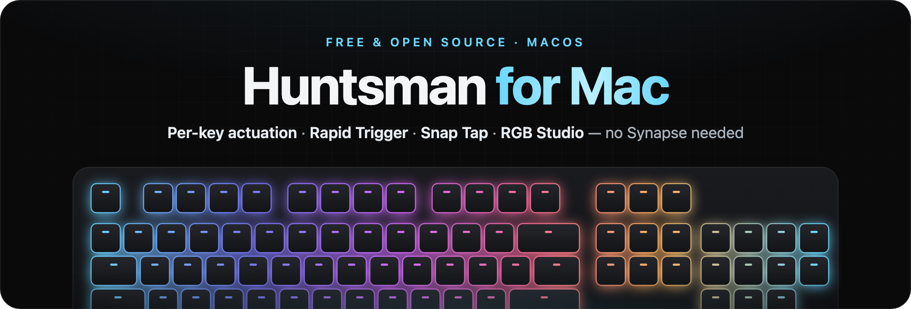
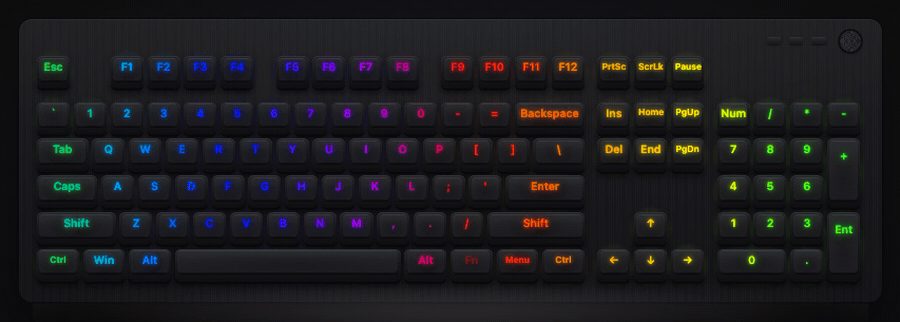
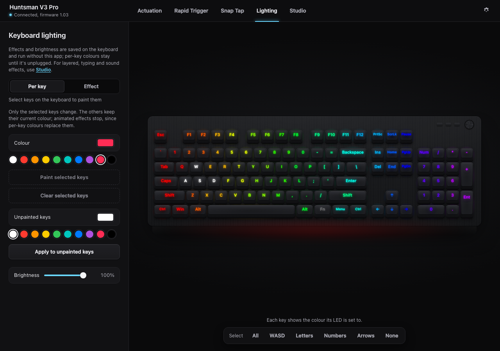
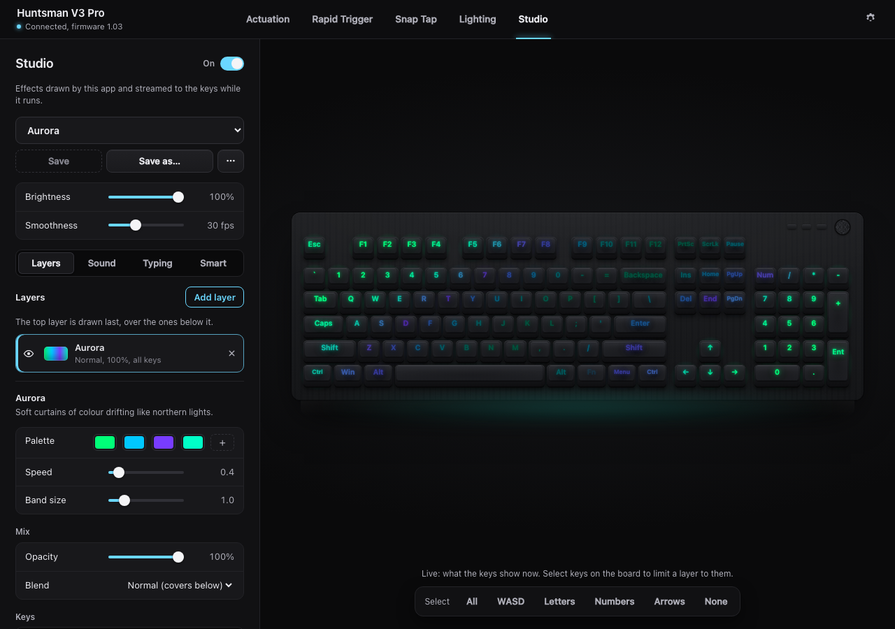
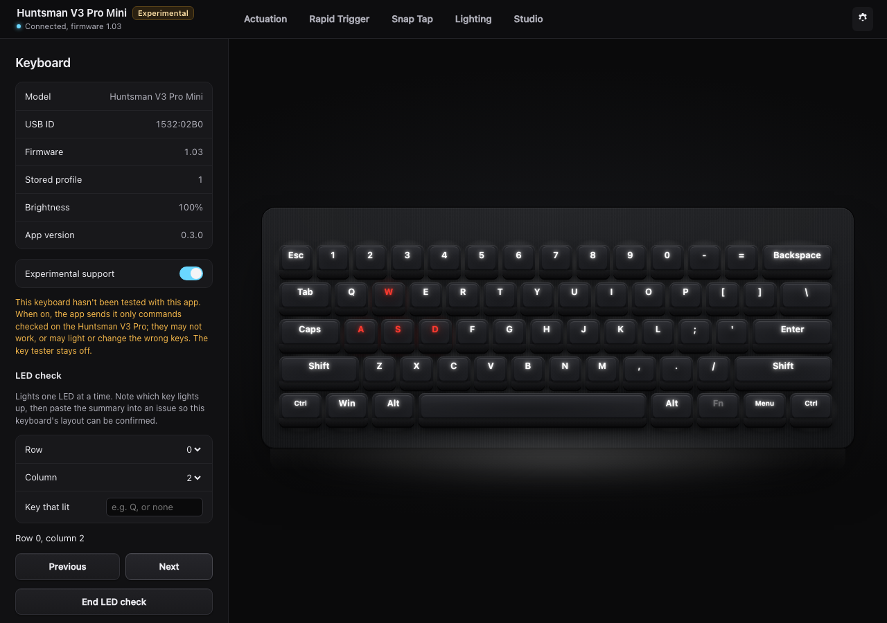
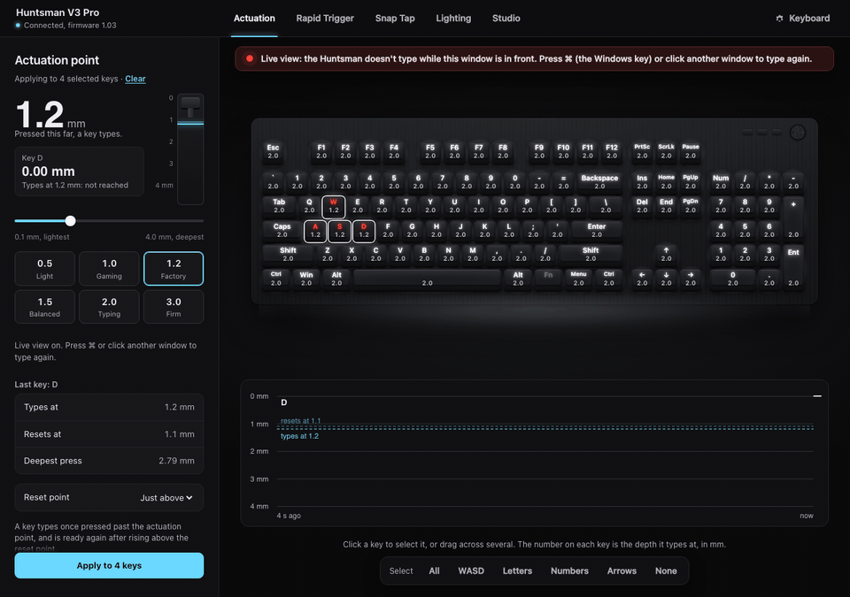

<p align="center">
  
</p>

<h1 align="center">Huntsman for Mac: Razer Huntsman V3 Pro on macOS, without Synapse</h1>

<p align="center">
  <b>Tune your Razer Huntsman V3 Pro on a Mac. No Synapse, no Windows, no virtual machine.</b>
</p>

<p align="center">
  <a href="https://github.com/samir777-eng/huntsman-for-mac/releases/latest"></a>
  <a href="LICENSE"></a>
  <a href="#supported-hardware"></a>
  <a href="#install"></a>
  <a href="#synapse-for-mac-vs-huntsman-for-mac"></a>
  <a href="#windows-experimental"></a>
</p>

<p align="center">
  <a href="#quick-start"><b>Quick start</b></a> ·
  <a href="#windows-experimental"><b>Windows</b></a> ·
  <a href="#features"><b>Features</b></a> ·
  <a href="#supported-hardware"><b>Supported models</b></a> ·
  <a href="#safety"><b>Safety</b></a> ·
  <a href="#faq"><b>FAQ</b></a>
</p>

<p align="center">
  
  <br>
  <sub>🌈 Lighting Studio's <b>Rainbow wave</b> preset, recorded in the app's demo mode.</sub>
</p>

The Huntsman V3 Pro has analog optical switches you can set to a tenth of a millimetre. Razer Synapse for Mac doesn't
support its settings (at the time of writing). **Huntsman for Mac** is a free, open-source app that does the job:
per-key actuation from 0.1 to 4.0 mm, Rapid Trigger, Snap Tap, per-key RGB, and a lighting studio that reacts to your
typing and your music.

### Synapse for Mac vs Huntsman for Mac

| On a Huntsman V3 Pro, from macOS | Synapse for Mac | Huntsman for Mac |
|---|:---:|:---:|
| 🎯 Change the actuation point (0.1 to 4.0 mm, per key) | ❌ | ✅ |
| ⚡ Rapid Trigger | ❌ | ✅ |
| 🎨 Per-key lighting | ❌ | ✅ |

## Quick start

Three steps and you're tuning:

1. **Get the code**

   ```bash
   git clone https://github.com/samir777-eng/huntsman-for-mac.git
   cd huntsman-for-mac
   ```

2. **Install it**

   ```bash
   ./install.sh
   ```

3. **Open it.** The installer opens **Huntsman for Mac** when it's done. Next time, find it in `~/Applications` or
   Spotlight.

You need Python 3.11 or newer, and Homebrew if libusb isn't installed yet. Details in [Install](#install).

On Windows? There's an experimental, untested build: see [Windows (experimental)](#windows-experimental).

> [!NOTE]
> Unofficial. Not made, endorsed or supported by Razer. "Razer" and "Huntsman" are Razer Inc. trademarks, used here
> only to say which keyboard this works with. Use at your own risk; see [Safety](#safety).

## Windows (experimental)

Version 0.4.0 adds a Windows build: the same app, as `Huntsman.exe`, with no Python or installer needed.

> [!WARNING]
> **Untested.** The Windows build has never run on a Windows PC with a keyboard. All that has run is the test suite
> (simulated keyboard) on GitHub's `windows-latest` runners, and a smoke test there of the built `Huntsman.exe`
> (`--version` and `--self-test`: it loads its code and data files, without opening a keyboard or a window). The
> window, the tray icon, start at login, typing reactions, smart lighting, the Synapse check and every exchange with a
> keyboard have not been seen working. A report either way helps: see
> [CONTRIBUTING.md](CONTRIBUTING.md#testing-on-windows).

What's different on Windows:

- **Every model is experimental**, the Huntsman V3 Pro too: nothing that changes the keyboard is sent until you turn
  on **Keyboard → Experimental support** (see [Experimental support](#experimental-support)). Reads always work,
  except while Razer Synapse runs (below).
- **No key tester.** It puts the keyboard into a mode where it stops typing, so it stays off on an untested platform.
- **Hands off while Razer Synapse runs.** Synapse overwrites the keyboard's live settings, and two programs talking
  to it at once mix up the replies. While Synapse (`RazerAppEngine.exe`, or Synapse 3 or 2) is running, the app and the
  lighting service don't open the keyboard at all, not even to read it: the window shows the last model it saw and
  says why. Quit Synapse, including its icon in the notification area, and the controls come back within a few
  seconds.
- **Windows Dynamic Lighting** can take over the keyboard's lights, so lighting changes may not show. When it's on,
  the window says so. To give the lights to this app: **Settings → Personalization → Dynamic Lighting**, choose the
  Razer Huntsman and turn Dynamic Lighting off for it (or turn off *Use Dynamic Lighting on my devices*). The app never
  changes this setting.
- The lighting service has a **tray icon** (notification area) instead of the menu bar icon. Smart lighting's app
  rules use the program name (like `steam.exe`).
- The download has **no command line** (`huntsman.py`). There's no USB driver to install: the app uses the
  keyboard's normal Windows driver (hidapi).

### Install on Windows

1. **Download** `Huntsman-for-Windows-<version>.zip` from the
   [latest release](https://github.com/samir777-eng/huntsman-for-mac/releases/latest).
2. **Unzip it** (right-click → *Extract All*) somewhere you'll keep it, for example `Documents`. You get a `Huntsman`
   folder; keep everything in it together.
3. **Close Razer Synapse**, including its icon in the notification area, or the app leaves the keyboard alone.
4. **Run `Huntsman.exe`.** It isn't code-signed, so Windows SmartScreen may say *Windows protected your PC*: click
   **More info**, then **Run anyway**.
5. Turn on **Keyboard → Experimental support** and read its warning.

The window uses the **Microsoft Edge WebView2 Runtime**. It's built into Windows 11; on Windows 10 it may be missing,
and then the window can't open. Install the *Evergreen* runtime from
[Microsoft's WebView2 page](https://developer.microsoft.com/microsoft-edge/webview2/) and run `Huntsman.exe` again.

### Start at login, tray icon and files

- Opening the app starts the **lighting service** (the tray icon; it may be hidden under the **^** arrow) and turns
  on **start at login** for the current user, no administrator rights needed: the registry value
  `HKEY_CURRENT_USER\Software\Microsoft\Windows\CurrentVersion\Run` → `Huntsman for Mac lighting`, set to
  `"<your folder>\Huntsman\Huntsman.exe" --service`. If you move the folder, open the app once from its new place.
  If you delete that value, the app leaves it deleted (it remembers in `state.json` that it added it once) until you
  turn Studio on in the app, which adds it back.
- The tray icon turns Studio on or off, switches presets, opens the app, and has **Quit lighting service**, which
  stops Studio and puts the keyboard's own lighting back. The service stays off until the next sign-in or the next
  time you open the app. Closing the window just closes it.
- Settings: `%APPDATA%\Huntsman for Mac\` (`state.json`, `presets.json`, `heatmap.json`,
  `first-launch-snapshot.json` and lock files).
- The service's pipe name and key: `%LOCALAPPDATA%\Huntsman for Mac\service.key`.
- Log: `%LOCALAPPDATA%\Huntsman for Mac\Logs\Huntsman for Mac.log`. The windowed app has no console, so everything
  it prints goes there.

### Uninstall on Windows

<details>
<summary>Quit, remove start at login, delete the folders</summary>

1. Tray icon → **Quit lighting service**, and close the window.
2. Remove start at login. In a Command Prompt:

   ```bat
   reg delete "HKCU\Software\Microsoft\Windows\CurrentVersion\Run" /v "Huntsman for Mac lighting" /f
   ```

   Or delete that value in Registry Editor. Switching it off in **Task Manager → Startup apps** (or **Settings → Apps
   → Startup**) only disables it; there it's probably listed by the program's description, *Huntsman for Mac (Windows
   build)* (not checked).
3. Delete the unzipped `Huntsman` folder.
4. To remove your settings and the log too, delete `%APPDATA%\Huntsman for Mac` and `%LOCALAPPDATA%\Huntsman for Mac`.

Settings stored on the keyboard (actuation, keyboard effects) stay on it.

</details>

## What it does

| | Feature | Saved on the keyboard? |
|---|---|---|
| 🎯 | [Actuation point](#actuation-and-the-key-tester), per key, 0.1 to 4.0 mm, with its reset point | Yes |
| 🔬 | [Key tester](#actuation-and-the-key-tester): watch each key's travel live, inside Actuation | – |
| ⚡ | [Rapid Trigger](#rapid-trigger-and-snap-tap), with press and release distances | No, kept until unplugged and sent again |
| 🥊 | [Snap Tap](#rapid-trigger-and-snap-tap) for one pair of keys | No, kept until unplugged and sent again |
| 💡 | [Keyboard lighting](#keyboard-lighting): static, breathing, spectrum, wave, reactive, starlight, brightness | Yes |
| 🎨 | [Per-key colours](#keyboard-lighting) | No, kept until unplugged and sent again |
| 🌈 | [Lighting Studio](#lighting-studio): layers, typing and sound effects, presets, smart lighting | No, drawn live by the app |
| 🧪 | [Six more Huntsman models](#supported-hardware), experimental and looking for testers | – |
| 🪟 | [A Windows build](#windows-experimental), experimental and untested | – |

"Sent again" means the lighting service puts it back when it starts, at login and after the installer runs.

## Features

<table>
  <tr>
    <td width="50%"><a href="#actuation-and-the-key-tester"></a></td>
    <td width="50%">
      <p><b>🎯 Actuation, to a tenth of a millimetre</b></p>
      Every key, anywhere from <b>0.1 mm</b> (a feather) to <b>4.0 mm</b> (the whole way down). It's stored on the
      keyboard, so it goes with the keyboard to other computers. Press a key on the Huntsman and watch it sink: the key
      tester runs live while Actuation is in front. <a href="#actuation-and-the-key-tester">More →</a>
    </td>
  </tr>
  <tr>
    <td width="50%">
      <p><b>⚡ Rapid Trigger and 🥊 Snap Tap</b></p>
      Rapid Trigger fires a key again as soon as it moves down by the press distance after rising by the release
      distance, anywhere in its travel. Snap Tap: while both keys of a pair are held, only the one pressed last
      counts. Both confirmed on a Huntsman V3 Pro. <a href="#rapid-trigger-and-snap-tap">More →</a>
    </td>
    <td width="50%"><a href="#keyboard-lighting"></a></td>
  </tr>
  <tr>
    <td width="50%"><a href="#lighting-studio"></a></td>
    <td width="50%">
      <p><b>🌈 Lighting Studio</b></p>
      Layers, 17 effects and fourteen built-in presets, reacting to your typing and your music. Studio runs in a small
      background lighting service, so close the app and your aurora keeps drifting.
      <a href="#lighting-studio">More →</a>
    </td>
  </tr>
  <tr>
    <td width="50%">
      <p><b>💡 Keyboard lighting and 🎨 per-key colours</b></p>
      Static, breathing, spectrum, wave, reactive and starlight run on the keyboard and are saved on it. Or select
      keys and paint them. <a href="#keyboard-lighting">More →</a>
      <p><b>🧪 Six more models, looking for testers</b></p>
      Experimental support for six more Huntsman models: untested so far, with guessed LED positions, plus an LED check
      to map their keys.
      <a href="#more-models-and-a-call-for-testers">More →</a>
    </td>
    <td width="50%"><a href="#more-models-and-a-call-for-testers"></a></td>
  </tr>
</table>

<sub>Screenshots and GIFs are from the app's demo mode (`ui/index.html?demo`), which simulates a keyboard.</sub>

### Actuation and the key tester

<p align="center">
  
  <br>
  <sub>🔬 The key tester in Actuation, recorded in demo mode (simulated key presses, not a hardware recording).</sub>
</p>

Pick keys on the board (or none, for all of them), drag the slider anywhere from **0.1 mm** (a feather) to **4.0 mm**
(the whole way down) and click Apply. Presets cover the usual suspects: 0.5 light, 1.0 gaming, 1.2 factory, 1.5
balanced, 2.0 typing, 3.0 firm. The reset point follows 0.1 mm above, or set it yourself. It's stored on the keyboard,
so it stays after unplugging and goes with the keyboard to other computers.

Not sure what 1.2 mm feels like? Just press a key on the Huntsman. The key tester ("live view") runs by itself while
the Actuation tab is open and the window is in front: the Huntsman sends travel readings instead of typing, the pressed
key sinks on the board, the meter follows it, a trace under the board names the key and draws its travel, and the panel
shows the last key, where it typed, where it reset and how deep you pressed. A banner over the board says the Huntsman
isn't typing; the first time, the panel explains why once. You can still pick keys and Apply while it runs.

Because the Huntsman doesn't type in live view, it stops, and the keyboard types again, as soon as you click another
window (or Cmd-Tab), open another tab, minimise the window or lock the screen, close the window or quit, and when the
keyboard is disconnected or you Reconnect. Coming back to the window or the tab starts it again. While it's paused the
trace and readings stay where they are, dimmed, so nothing jumps. After 5 minutes without a key press it pauses: click
**Resume** on the trace, or come back to the window or the tab. If it can't start, the panel says why once, with
**Try again** (and **Open Privacy settings** when Input Monitoring isn't allowed); it doesn't keep retrying.

The app opens on the tab you used last, so it only stops the Huntsman typing at launch if you left it on Actuation.
The very first launch opens Lighting.

The key tester is only offered on the Huntsman V3 Pro (1532:02A6), the one model tested with this app.

#### Actuation on the V2 Analog

Experimental and untested with this app. The Huntsman V2 Analog (1532:0266) measures travel differently: its keyboard
acts between **1.62 mm** and **3.56 mm**, so that's the slider's range, in 0.01 mm steps, with presets at 1.62, 2.0,
2.5, 3.0 and 3.56. Unless you set one (the window's *Just above*, and the command line), the reset point follows
0.1 mm above the new actuation point, the same in the saved and the live profile, no shallower than 1.54 mm; a
custom one stays
at least 0.1 mm above (the firmware rule is 10 bytes, about 0.08 mm). The 0.01 mm steps are this app's choice
(easyrazer uses 0.1 mm). The scale and limits come from easyrazer, which checked the 3.56 mm end on this
keyboard; the 1.62 mm end and the reset point rules come from its reading of the firmware and haven't been seen
working. Only the two depth bytes of each key change: the key's assignment (what it types, or a macro) is written
back as read, and every write is read back. A key set by Razer Synapse reads 0/0, which the keyboard treats as
1.62 mm, so the app shows it that way. Only the normal layer is changed; a Hypershift (Fn) depth is left alone.
There's no *Restore factory depth* on this model, because its factory depth isn't known; the first-launch snapshot
(`huntsman.py restore-snapshot`) puts every key back as it was.

### Rapid Trigger and Snap Tap

**Rapid Trigger** fires a key again as soon as it moves down by the press distance after rising by the release
distance, anywhere in its travel. Both distances go from 0.1 to 1.0 mm, and there's a *Stay on for the whole press*
option.

**Snap Tap** takes one pair of keys (usually A and D): while both are held, only the one pressed last counts. In the
window, turn on its switch, click the two keys on the keyboard (or pick them in the lists) and choose Apply.

Both were confirmed on a Huntsman V3 Pro. The keyboard forgets them when unplugged, so the lighting service sends them
again when it starts.

### Keyboard lighting

The **Lighting** tab drives the keyboard's own effects: static, breathing, spectrum, wave, reactive and starlight, plus
brightness. They run on the keyboard and are saved on it, so they keep going without the app. Colours are corrected so
the keys match the colour you pick. (The Fire effect some Razer keyboards have is refused by this one's firmware, so
it isn't offered.)

**Per key** lets you select keys and paint them. The keyboard keeps per-key colours until it's unplugged; the app and
the lighting service send them again.

### Lighting Studio

Studio is where the app draws every frame itself and streams it to the keys, so effects can stack, react and change
with what you're doing.

- **Layers.** Stack effects; the top layer is drawn last. Each layer has its own colours and settings, opacity, a
  blend mode (normal, add, screen, multiply, brightest) and a key set (all keys, or the keys you select).
- **17 effects.** Basic: solid colour, gradient (linear or radial, 2 to 5 colours), rainbow wave, colour cycle,
  breathing. Ambient: aurora, matrix rain, plasma, fire, starfield. Sound: audio spectrum (bars across the keyboard),
  audio pulse. Typing: ripple, afterglow, explosion, trail, and a typing heatmap.
- **Presets.** Fourteen built in: Rainbow wave, Aurora, Gaming WASD, Typing glow, Music, Fire, Matrix, Calm breathing,
  Plasma, Starfield, Ripple, Spectrum bars, Sunset, Neon cycle.
  Save, save as, rename, duplicate, delete, and import or export a preset as a JSON file. Built-in presets can't be
  changed; save a copy instead. Brightness and smoothness (15 to 60 frames a second) apply to every preset.
- **Sound.** Choose the input in Studio → Sound. A microphone hears the room. For the Mac's own sound, install a
  loopback device such as [BlackHole](https://github.com/ExistentialAudio/BlackHole), send your output to it (for
  example with a Multi-Output Device in Audio MIDI Setup) and choose it as the input. Sensitivity sets how strongly
  the lights react.
- **Smart lighting** (Studio → Smart). Dim the keys or turn them off after some minutes without input; turn them off
  while the Mac sleeps or the screen is locked; show a chosen preset while a given app is in front.
- **Keeps running after you quit.** Studio runs in a small background **lighting service** (Huntsman Lighting), not in
  the window. Close the app and your aurora keeps drifting. See [Lighting service and menu bar](#lighting-service-and-menu-bar).

When Studio is turned off or the lighting service quits, the keyboard's own lighting comes back.

> [!TIP]
> **Privacy.** Key presses and sound are processed in memory, frame by frame, to draw the lights. Nothing is recorded,
> logged or sent anywhere. The typing heatmap is off by default; when on, it stores only how many times each key was
> pressed (`heatmap.json`, on this Mac), never which keys in which order, and **Reset heatmap** deletes it.

### More models, and a call for testers

Version 0.3.0 adds **experimental support** for six more Huntsman models. Nobody has tried them with this app yet.
They get only commands already checked on the V3 Pro, nothing that changes them is sent until you turn on
**Keyboard → Experimental support**, and their LED positions are a guess. The **LED check** lights one LED at a time
so you can tell us which key it belongs to.

🙋 **Own one of them?** You can turn our guess into a fact. See
[Supported hardware](#supported-hardware) and [CONTRIBUTING.md](CONTRIBUTING.md#testing-an-experimental-model).

(The Keyboard tab screenshot above is from demo mode, which previews any model without a keyboard; it isn't a hardware
result.)

## Supported hardware

Wired only. Only the Huntsman V3 Pro (1532:02A6) has been tested with this app. The other models are experimental:
the app sends them only commands checked on the V3 Pro, and their LED positions are a guess until a tester confirms
them with the [LED check](#led-check).

| Model | USB ID | Status | What the app offers |
|---|---|---|---|
| Huntsman V3 Pro | 1532:02A6 | ✅ Tested | Everything: actuation, Rapid Trigger, Snap Tap, lighting, per-key colours, Studio, key tester |
| Huntsman V3 Pro TKL | 1532:02A7 | 🧪 Experimental, untested | Lighting, per-key colours, Studio, actuation, Rapid Trigger, Snap Tap. No key tester |
| Huntsman V3 Pro 8KHz | 1532:02CF | 🧪 Experimental, untested | Lighting, per-key colours, Studio, actuation, Rapid Trigger, Snap Tap. No key tester |
| Huntsman V3 Pro Mini | 1532:02B0 | 🧪 Experimental, untested | Lighting, per-key colours, Studio, actuation, Rapid Trigger, Snap Tap. No key tester |
| Huntsman V2 | 1532:026C | 🧪 Experimental, untested | Lighting, per-key colours and Studio only |
| Huntsman V2 TKL | 1532:026B | 🧪 Experimental, untested | Lighting, per-key colours and Studio only |
| Huntsman V2 Analog | 1532:0266 | 🧪 Experimental, untested | Lighting, per-key colours, Studio, actuation (1.62 to 3.56 mm). No Rapid Trigger, Snap Tap, key tester, factory depth reset or starlight effects |

On the experimental models none of this has been seen working yet. The V2 and V2 TKL have no actuation, Rapid
Trigger or Snap Tap tabs and no key tester. The V2 Analog has actuation only, on its own scale (see
[Actuation on the V2 Analog](#actuation-on-the-v2-analog)); its Rapid Trigger and Snap Tap run in Razer's software on
the computer, not on the keyboard, so the app doesn't offer them. If more than one supported keyboard is plugged in,
the app uses the first one it finds in the order of this table.

Macs: tested on Apple silicon with macOS 26. Intel Macs and earlier macOS versions are untested; they will probably
work, and a report either way helps.

Windows: untested on a PC, and every model, the V3 Pro too, is experimental there, with no key tester. See
[Windows (experimental)](#windows-experimental).

### Experimental support

On an experimental model the app connects and reads the model, firmware, profile, effect and brightness, but changes
nothing until you turn on **Keyboard → Experimental support**. Until then every control that would change the
keyboard is off, with a note pointing at the switch, and the lighting service doesn't send saved settings or run
Studio.

Turning it on allows lighting effects, brightness, per-key colours and Studio, and on the V3 Pro models also
actuation, Rapid Trigger, Snap Tap and *Restore factory depth*. The switch shows this warning:

> [!WARNING]
> This keyboard hasn't been tested with this app. When on, the app sends it only commands checked on the Huntsman V3
> Pro; they may not work, or may light or change the wrong keys. The key tester stays off.

The switch is remembered (in `state.json`) and applies to every experimental model. Turning it off stops Studio first,
so the keyboard's own lighting comes back while changes are still allowed. From the command line:
`huntsman.py experimental on` or `huntsman.py experimental off`.

### LED check

In the Keyboard tab of an experimental model, once Experimental support is on:

1. Click **Start LED check**. Studio turns off, and only the LED at the chosen row and column lights up, in white.
2. Type the key that lit in **Key that lit** (or *none*), then click **Next**. **Previous** and the Row and Column
   lists move around the matrix.
3. Click **Copy summary** and paste it into a [new model issue](.github/ISSUE_TEMPLATE/new_model.md). The summary
   lists the model, USB ID, firmware, app version and every cell you noted.
4. Click **End LED check** to put the keyboard's lighting back.

## What's been checked on real hardware

Checked on 2026-11-17 with a Huntsman V3 Pro (1532:02A6), firmware 1.03, wired, on macOS 26 with Apple silicon.

| ✅ Checked on hardware | ⏳ Not checked yet |
|---|---|
| Actuation and reset points: written, read back, still there after unplugging | The six models with [experimental support](#experimental-support), including actuation on the V2 Analog |
| Rapid Trigger and Snap Tap turned on | Intel Macs |
| Keyboard lighting effects, per-key colours and brightness | macOS versions before 26 |
| Colour correction (the keyboard matches the picker) | |
| Key tester readings, and switching the keyboard back to typing afterwards | A hard kill (SIGKILL) during a key test; this relies on the recovery on the next connect, which is checked |
| Quitting the app with SIGTERM during a key test: the keyboard types again | The name macOS shows in the lighting service's permission prompts |
| A keyboard left in test mode is put back to typing the next time the app or the command line connects | Keyboard lighting coming back at logout or shutdown |
| Checksums on the keyboard's replies; actuation is written to the saved copy before the live copy | The lighting service restarting itself after a crash |
| Lighting Studio: built-in presets, layers, settings, saving presets, Sound, Typing and Smart panels, music through the microphone | Smart lighting over a long session (real sleep and screen lock) |
| Studio effects keep running after the app quits | System sound through a loopback device such as BlackHole |
| | install.sh putting the previous app back after a failed build |
| | Anything on [Windows](#windows-experimental): the build has never run on a PC with a keyboard |

**Version 0.3.0** was checked again on the same keyboard: the window, actuation, Rapid Trigger and Snap Tap, keyboard
effects, per-key colours and brightness, Studio typing and ambient presets (also after quitting the app), and
starting and stopping the key tester with typing coming back. All passed. The key tester's new place in Actuation was
then checked too (2026-11-18): the meter and readings update, and typing comes back after stopping.

**Version 0.4.0** was partly checked on the same keyboard before its UX changes (2026-11-18): the window, the menu
bar icon, actuation, lighting, Studio after quitting the app, and the key tester; the no-keyboard screen and
Reconnect on 2026-11-20. Not checked on the keyboard yet: the Mixed readout and Apply confirmation, Snap Tap's switch
and picking keys on the board, Studio's preview while off, the six new presets, and the key tester since the UX
changes. The golden tests show every byte sent to the V3 Pro is unchanged. The Windows build and the V2 Analog's
actuation are untested.

## Install

You need:

- A Mac with the keyboard plugged in by USB.
- Python 3.11 to 3.13, from Homebrew (`brew install python@3.13`) or [python.org](https://www.python.org/downloads/macos/).
  Newer versions are used if nothing older is found; the installer says they're untested.
- [Homebrew](https://brew.sh), if libusb isn't installed yet: the installer uses it to add libusb.

Then run `./install.sh` from the project folder (see [Quick start](#quick-start)). It installs:

- **Huntsman for Mac.app** in `~/Applications`. It carries its own copy of the code and Python environment, and is
  signed ad hoc on your Mac (no Apple developer account involved).
- **libusb**, through Homebrew, if it's missing.
- **The lighting service**, `Huntsman Lighting.app`, inside the app (`Contents/Library/LoginItems`), and a LaunchAgent
  (`io.github.huntsman-for-mac.lighting`) that starts it now and at every login. It replaces the `apply-saved` login
  item of earlier versions, which the installer removes.

> [!TIP]
> **Try it without a keyboard:** open `ui/index.html?demo` in a browser. Add `&model=02B0` (or any USB product ID from
> the table) to preview another model; a list in the header switches between them.

### Update

<details>
<summary>Three steps: quit, pull, install</summary>

1. Quit the app (Cmd-Q). The installer stops and restarts the lighting service itself.
2. `git pull`
3. `./install.sh`

Run `./install.sh` again after Homebrew upgrades Python too: the app's environment points at the Python it was built
with.

</details>

### Uninstall

<details>
<summary>Remove the app, and optionally your settings</summary>

Quit the app first, then:

```bash
./uninstall.sh          # stops the lighting service, removes the app and its login item; keeps your settings and the log
./uninstall.sh --all    # also deletes your settings, the first-launch snapshot and the log
```

Stopping the lighting service puts the keyboard's own lighting back; nothing else on the keyboard changes. Use
*Restore factory depth* in the app first if you want the keyboard back to its defaults.

</details>

## Permissions

macOS asks the first time a feature needs one of these.

| Permission | For | Listed as |
|---|---|---|
| Input Monitoring | The key tester | Huntsman for Mac |
| Input Monitoring | Studio's typing effects and heatmap | Huntsman Lighting |
| Microphone | Studio's sound effects | Huntsman Lighting |

The lighting service has its own small app bundle so that macOS should list it as **Huntsman Lighting**. That name
hasn't been confirmed on hardware yet; it may show up as **Python** instead.

### Input Monitoring for the key tester

<details>
<summary>If you said no, or nothing was asked</summary>

The key tester reads the keyboard's travel reports, which macOS treats as input monitoring. If you said no, or
nothing was asked:

1. Open **System Settings → Privacy & Security → Input Monitoring**.
2. Turn on **Huntsman for Mac**. If it isn't listed but **Python** is, turn that on instead. If neither is listed,
   click **+** and choose `~/Applications/Huntsman for Mac.app`.
3. Quit and reopen the app.

Re-installing replaces the app, so macOS may ask again, or the switch may need to be turned off and on.

</details>

### Studio's permissions

<details>
<summary>Input Monitoring and Microphone for Huntsman Lighting</summary>

- **Input Monitoring → Huntsman Lighting**, for typing effects and the heatmap. The service only listens while a
  preset with a typing effect is on or the heatmap is counting.
- **Microphone → Huntsman Lighting**, for sound effects. The service only listens while a preset with a sound effect
  is on. If access is refused, Studio shows where to turn it on.
- After changing either, use **Quit lighting service** in the menu bar, then turn Studio on again in the app.

</details>

## Lighting service and menu bar

The keyboard icon in the menu bar belongs to the lighting service. It turns Studio on or off, switches presets, opens
Huntsman for Mac, and has **Quit lighting service**, which stops Studio and puts the keyboard's own lighting back.

<details>
<summary>When it starts, restarts and pauses</summary>

- The service starts at login and when the installer finishes. When it starts, it sends per-key colours, Rapid
  Trigger and Snap Tap to the keyboard again and starts Studio if it was on.
- It's set up to restart if it crashes (not checked on hardware yet). After *Quit lighting service* it stays off
  until the next login or the next time you open the app: the window starts it again when it opens (it reads
  Studio's state from the service).
- Quitting the app window (red button, Cmd-Q) just closes the window; the lighting keeps running.
- While the app changes the keyboard (actuation, keyboard effects, per-key colours, brightness, the key tester), the
  service pauses its frames.

</details>

## Command line

The installed app includes a command-line tool:

```bash
APP=~/Applications/"Huntsman for Mac.app"/Contents/Resources
"$APP/venv/bin/python" "$APP/code/huntsman.py" status
```

<details>
<summary>All commands</summary>

| Command | What it does |
|---|---|
| `status` | Model, USB ID and status, the Experimental support switch (experimental models), firmware, saved profile, brightness, and the A key's actuation and reset points (models with adjustable actuation) |
| `experimental on`, `experimental off` | Turn Experimental support on or off. Doesn't need a keyboard |
| `depth 2.0` | Every key types at 2.0 mm (0.1 to 4.0; on the V2 Analog 1.62 to 3.56, in 0.01 mm steps); the reset point follows 0.1 mm above |
| `depth 0.5 W A S D` | Only those keys |
| `color 255 255 255` | Solid colour, saved on the keyboard |
| `spectrum`, `wave`, `off` | Built-in effects, saved on the keyboard |
| `brightness 80` | Brightness, 0 to 100 |
| `apply-saved` | Send per-key colours, Rapid Trigger and Snap Tap again (the lighting service does this when it starts) |
| `factory` | Every key back to 1.2 mm; Rapid Trigger and Snap Tap off. Refused on the V2 Analog (factory depth unknown) |
| `restore-snapshot` | Put every key back exactly as it was on the app's first launch |
| `--version` | Print the version |
| `help` | Print this list |

</details>

## Safety

The app writes to the keyboard's memory using commands the community worked out by reverse engineering, not from
Razer documentation. So it's careful:

<details open>
<summary><b>🛡️ How it stays careful</b></summary>

- **Checked replies.** Every command checks that the keyboard's reply matches the request and passes its checksum.
  Actuation writes are also read back key by key; lighting writes are not read back.
- **Checked on hardware.** Actuation was written, read back and confirmed after unplugging. Static lighting and
  brightness were checked to stay after unplugging.
- **Your original settings are saved.** On first launch the app copies every key's settings to
  `~/Library/Application Support/Huntsman for Mac/first-launch-snapshot.json`; `huntsman.py restore-snapshot` puts
  them back. The snapshot records its model and is never written to another one. There is one snapshot per Mac user:
  a second model plugged in later gets none. The V2 and V2 TKL have no actuation settings, so they get none either.
- **Factory reset.** *Restore factory depth* (in the app, or `huntsman.py factory`) puts every key back to 1.2 mm and
  turns off Rapid Trigger and Snap Tap. Not on the V2 Analog, whose factory depth isn't known: use the snapshot.
- **The key tester always lets go.** The keyboard goes back to typing when you leave the Actuation tab or the window
  goes to the background, after 5 minutes without a key press, when you close the window, when the app quits, and when macOS ends it (SIGTERM). If the app is killed outright, the next time the
  app or the command line connects it puts the keyboard back to typing. Unplugging and replugging should also work,
  since test mode isn't stored.
- **Experimental models** get only commands already checked on the Huntsman V3 Pro, and nothing that changes them is
  sent until Experimental support is on. The key tester is never offered on them.
- **On Windows** every model counts as experimental, the key tester is never offered, and nothing is written while
  Razer Synapse is running. See [Windows (experimental)](#windows-experimental).
- **If everything else fails,** connecting the keyboard to Windows with Razer Synapse should reset it. This hasn't
  been needed or tried.

</details>

## Troubleshooting

<details>
<summary><b>"No supported Razer Huntsman found"</b></summary>

- Connect it with its USB cable, directly or through a powered hub, then open Keyboard info (the gear icon) and click
  *Reconnect*.
- Check the model: **Apple menu → About This Mac → More Info → System Report → USB**. Look for a Razer device with
  Vendor ID 0x1532 and one of the Product IDs in [Supported hardware](#supported-hardware). Other IDs aren't supported.
- Only one program can use the keyboard's control interface. Quit Razer Synapse, OpenRazer-based tools or anything
  else that talks to Razer devices, then click *Reconnect*.

</details>

<details>
<summary><b>"libusb is missing"</b></summary>

Run `brew install libusb`, then `./install.sh` again.

</details>

<details>
<summary><b>The app doesn't open, or macOS says it's damaged or from an unidentified developer</b></summary>

- The installer removes the download quarantine flag and signs the app ad hoc. If it printed a signing warning, run
  `./install.sh` again and keep the output for a bug report.
- You can also right-click the app, choose **Open**, and confirm.
- Check the log: `~/Library/Logs/Huntsman for Mac.log`.

</details>

<details>
<summary><b>The app stops working after a Python upgrade</b></summary>

Run `./install.sh` again.

</details>

<details>
<summary><b>Installer says the app is running</b></summary>

Quit the window (Cmd-Q), then run the installer again. The lighting service doesn't need quitting; the installer
stops and restarts it.

</details>

<details>
<summary><b>The keyboard stopped typing</b></summary>

It was left in test mode. Unplug it and plug it back in; opening the app, or running any `huntsman.py` command, also
puts it back to typing.

</details>

<details>
<summary><b>Settings aren't sent again after login, or Studio stops when the app quits</b></summary>

- Check the lighting service is running: `launchctl print gui/$(id -u)/io.github.huntsman-for-mac.lighting`. Start it
  by hand with `launchctl kickstart gui/$(id -u)/io.github.huntsman-for-mac.lighting` (the app does this when you use
  Studio).
- Check **System Settings → General → Login Items & Extensions**; it may be listed as Huntsman Lighting or Python. It
  must be allowed.
- Its output goes to the same log, `~/Library/Logs/Huntsman for Mac.log`.

</details>

<details>
<summary><b>Studio lights don't follow typing or sound</b></summary>

Studio → Typing or Sound shows the reason. Usually Input Monitoring or Microphone access is off for Huntsman Lighting
(see [Permissions](#permissions)); use *Quit lighting service* in the menu bar after turning it on, then turn Studio
on again. For the Mac's own sound, the input must be a loopback device such as BlackHole, not the microphone.

</details>

## FAQ

<details>
<summary><b>Does Razer Synapse work with the Huntsman V3 Pro on Mac?</b></summary>

Not at the time of writing: Razer Synapse for Mac doesn't support the Huntsman V3 Pro's settings, so actuation, Rapid
Trigger and per-key lighting can't be changed there. This app fills that gap.

</details>

<details>
<summary><b>How do I change the actuation point of a Razer Huntsman V3 Pro on macOS?</b></summary>

Open Huntsman for Mac, select keys (or none for all keys), pick a depth between 0.1 and 4.0 mm and click Apply. The
setting is stored on the keyboard, so it stays after unplugging and also works on other computers.

</details>

<details>
<summary><b>Can I use Rapid Trigger or Snap Tap on a Mac?</b></summary>

Yes, from the Rapid Trigger and Snap Tap tabs. Both have been confirmed on a Huntsman V3 Pro; please report how they
work on other models.

</details>

<details>
<summary><b>Can I set per-key RGB lighting without Synapse?</b></summary>

Yes. Use Lighting → Per key to colour individual keys, or Effect for spectrum, wave, breathing, reactive and
starlight. Ripple and other typing effects are in Studio.

</details>

<details>
<summary><b>Do I need Windows, Boot Camp or a virtual machine?</b></summary>

No. It talks to the keyboard directly over USB from macOS.

</details>

<details>
<summary><b>Does it work on Windows?</b></summary>

There's an experimental Windows build (`Huntsman-for-Windows-<version>.zip` on the releases page), but it has never
been run on a Windows PC with a keyboard, so nobody knows yet. On Windows every model needs Experimental support
switched on, there's no key tester, and the app leaves the keyboard alone while Razer Synapse is running. See
[Windows (experimental)](#windows-experimental).

</details>

<details>
<summary><b>Is it free?</b></summary>

Yes. It's open source under GPL-3.0-or-later, with no account, no telemetry and no paid tier.

</details>

<details>
<summary><b>Which keyboards are supported?</b></summary>

The Razer Huntsman V3 Pro (full size, USB ID 1532:02A6) is tested. The V3 Pro TKL, V3 Pro 8KHz, V3 Pro Mini, V2, V2
TKL and V2 Analog have experimental support: untested, and off until you turn on Experimental support. See
[Supported hardware](#supported-hardware).

</details>

<details>
<summary><b>I have one of the experimental models. How can I help?</b></summary>

Turn on Experimental support, run the LED check, and report what worked and what didn't. The steps are in
[CONTRIBUTING.md](CONTRIBUTING.md#testing-an-experimental-model).

</details>

<details>
<summary><b>Why is there no key tester on my model?</b></summary>

The key tester switches the keyboard into a mode where it stops typing. It's only offered on a model that has been
tested, so an untested keyboard can't be left unable to type. The V2 and V2 TKL also have no analog keys to test.

</details>

## Under the hood

The app talks to the keyboard's control interface with USB control transfers through libusb, which avoids Razer's
macOS driver (it keeps that interface to itself). Settings go to two places: the copy the keyboard is using right now,
and the saved onboard profile. The key tester puts the keyboard into "driver mode" and reads its travel reports
(report `0x0B`) through IOKit. On Windows the same commands go through hidapi as feature reports on the same
interface (no driver swap), the app and the lighting service talk over a named pipe, and driver mode is never used.

<details>
<summary>Code map, and where your settings live</summary>

- `huntsman_core.py`: protocol and USB transport · `models.py`: the supported models · `layouts/`: their key layouts
- `depth_stream.py`: live travel readings
- `app.py` and `ui/`: the window and control panel (`ui/studio.js` is the Studio tab)
- `service.py`: the lighting service, which runs Studio and the menu bar icon (`menubar.py`) in the background
- `ipc.py`: the local socket between the app and the service (`service.sock`, JSON lines, owner-only): Studio
  commands, live preview frames, and pause leases the app holds around every keyboard operation (they expire on their
  own, so a crashed app never leaves the lighting paused)
- `studio.py`: Studio controller (presets, settings, listeners, smart lighting) · `lighting/`: effects, layers,
  presets and the engine that streams per-key frames
- `inputs/`: key presses (IOKit), sound levels (sounddevice) and smart-lighting signals (idle, sleep, lock, front app)
- `huntsman.py`: the command line
- `platforms/`: which OS this is, folders and file locks, and the Windows pieces (hidapi transport, tray icon, start
  at login, Raw Input typing, smart-lighting events, the Synapse check, the build manifest)

Your settings and logs live in:

- `~/Library/Application Support/Huntsman for Mac/`: `state.json` (settings the keyboard forgets when unplugged,
  Experimental support, and Studio and smart lighting settings), `presets.json` (your Studio presets), `heatmap.json`
  (press counts, only if the heatmap is on), `first-launch-snapshot.json`, lock files, and the lighting service's
  socket (`service.sock`).
- `~/Library/Logs/Huntsman for Mac.log`

</details>

## Contributing

🙌 Hardware reports are the most useful thing right now: experimental models, Windows, Intel Macs and older macOS. See
[CONTRIBUTING.md](CONTRIBUTING.md) for the steps, the safety rule for new commands, and how to run the tests:

```bash
python3 -m venv .venv && .venv/bin/pip install -r requirements.txt -r requirements-dev.txt
.venv/bin/python -m playwright install chromium
.venv/bin/python -m pytest -q tests
```

The tests use a simulated keyboard and never touch USB. The interface tests open `ui/index.html?demo` in a headless
browser; they're skipped if Playwright isn't installed. GitHub Actions runs them on macOS and Windows for every push
and pull request. Security problems: see [SECURITY.md](SECURITY.md).

## Credits

This project stands on the shoulders of people who reverse engineered these keyboards first:

- [easyrazer](https://github.com/janeblower/easyrazer) (GPL-3.0-or-later): the key IDs, layout geometry and LED map in
  `layout.json` and `keymap.json` are derived from it, as are the analog actuation, Rapid Trigger, Snap Tap and
  per-key frame commands.
- [OpenRazer](https://github.com/openrazer/openrazer) (GPL-2.0-or-later driver): protocol facts only, the report
  format and lighting commands. No code is copied.
- [SensorFinder for Razer Huntsman](https://github.com/ohy1/SensorFinder-for-Razer-Huntsman) (MIT): protocol facts
  only, the actuation and release-point rules and the travel report format.

See [NOTICE](NOTICE) for details.

## Trademarks

Unofficial. Not made, endorsed or supported by Razer Inc. "Razer" and "Huntsman" are trademarks of Razer Inc., used
only to say which keyboard this software works with. No Razer logos, artwork or software are included.

## License

GPL-3.0-or-later. See [LICENSE](LICENSE) and [NOTICE](NOTICE).

<p align="center"><sub>Made for Mac people with a Huntsman on the desk. ⌨️✨ If it helps you, a ⭐ helps others find it.</sub></p>
