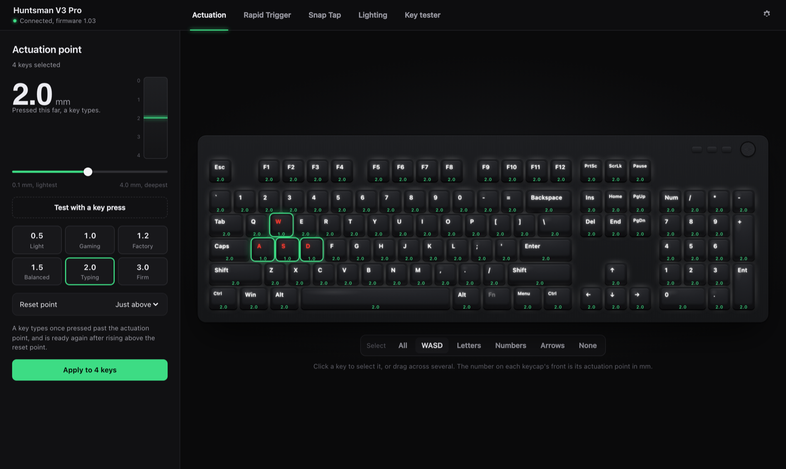

# Huntsman for Mac

Set the actuation point, Rapid Trigger, Snap Tap and lighting of a **Razer Huntsman V3 Pro** on macOS, where Razer Synapse doesn't support this keyboard. It also includes a live key tester that shows how far each key is pressed.

> Unofficial. Not made, endorsed or supported by Razer. "Razer" and "Huntsman" are Razer Inc. trademarks, used here only to say which keyboard this works with. Use at your own risk; see [Safety](#safety).



## What it does

| Feature | Saved on the keyboard | Notes |
|---|---|---|
| Actuation point, per key, 0.1 to 4.0 mm | Yes | The reset point follows 0.1 mm above it, or set it yourself |
| Lighting effects (static, breathing, spectrum, wave, reactive, ripple, starlight, fire) | Yes | Colours are corrected so the keyboard matches the colour you pick |
| Brightness | Yes | |
| Per-key colours | No, kept until unplugged | Sent again when the app opens and at login |
| Rapid Trigger | No, kept until unplugged | **Experimental**: not yet confirmed on real hardware |
| Snap Tap (one pair) | No, kept until unplugged | **Experimental**: not yet confirmed on real hardware |
| Live key tester and actuation meter | – | While testing, the keyboard sends travel readings instead of typing. Travel readings and switching back were checked on hardware; the full flow inside the installed app still needs testers |

## Supported hardware

Only tested with the **Huntsman V3 Pro (USB ID 1532:02A6), firmware 1.03, wired**, on macOS 26 (Apple silicon). Other Huntsman V3 models use the same commands, but the app only connects to 1532:02A6 until someone tests them. If you own another model, please open an issue.

## Install

You need Homebrew and Python 3.10 or newer.

```bash
git clone <this repository>
cd huntsman-mac
./install.sh
```

This installs:
- **Huntsman for Mac.app** in `~/Applications`. It carries its own copy of the code and Python environment.
- **libusb**, through Homebrew, if it's missing.
- **A login item** that sends per-key colours, Rapid Trigger and Snap Tap to the keyboard again after you log in.

Run `./install.sh` again after pulling updates. `./uninstall.sh` removes the app and the login item; add `--all` to also delete your saved settings.

The key tester needs **Input Monitoring** permission. macOS asks the first time you press *Test*. If you said no, turn it on in System Settings → Privacy & Security → Input Monitoring.

To preview the interface without a keyboard, open `ui/index.html?demo` in a browser.

## Command line

```bash
APP=~/Applications/"Huntsman for Mac.app"/Contents/Resources
$APP/venv/bin/python $APP/code/huntsman.py status
$APP/venv/bin/python $APP/code/huntsman.py depth 1.5 W A S D
$APP/venv/bin/python $APP/code/huntsman.py color 255 255 255
$APP/venv/bin/python $APP/code/huntsman.py factory
```

Run it with no arguments for the full list.

## Safety

The app writes to the keyboard's built-in memory using commands the community worked out by reverse engineering, not from Razer documentation.
- **Actuation and lighting** have been checked on real hardware: written, read back and confirmed after unplugging.
- Each write checks that the keyboard's reply matches the request, then reads the value back.
- **Restore factory depth** (in the app, or `huntsman.py factory`) puts every key back to 1.2 mm and turns off Rapid Trigger and Snap Tap.
- **Your original settings are saved.** On first launch the app copies every key's settings to `~/Library/Application Support/Huntsman for Mac/first-launch-snapshot.json`; `huntsman.py restore-snapshot` puts them back.
- **If the key tester ever leaves the keyboard not typing** (for example, the app crashed mid-test), unplug and replug it. Test mode isn't stored, so a replug should bring back normal typing; this has not been confirmed on hardware yet. The app always tries to switch back by itself: when you stop, when you close the window, at exit, and after 60 seconds.
- **If everything else fails**, connecting the keyboard to Windows with Razer Synapse resets it.

## How it works

The app talks to the keyboard's control interface with USB control transfers through libusb. This avoids Razer's macOS driver, which keeps that interface to itself. Settings go to two places: the copy the keyboard is using right now, and the saved onboard profile. The live tester puts the keyboard into "driver mode" and reads its travel reports (report `0x0B`) through IOKit.

- `huntsman_core.py`: protocol and USB transport
- `depth_stream.py`: live travel readings
- `app.py` and `ui/`: the window
- `huntsman.py`: the command line

Run the tests with `pip install pytest && python -m pytest tests`. They use a simulated keyboard.

## Credits

This builds on the protocol work of:
- [OpenRazer](https://github.com/openrazer/openrazer) (GPL-2.0): report format and lighting commands
- [easyrazer](https://github.com/janeblower/easyrazer) (GPL-3.0): analog actuation, Rapid Trigger, Snap Tap and per-key frame commands, plus the key IDs, layout geometry and LED map in `layout.json` and `keymap.json`
- [SensorFinder for Razer Huntsman](https://github.com/ohy1/SensorFinder-for-Razer-Huntsman) (MIT): actuation and release-point rules, and the travel report format

## License

GPL-3.0-or-later. See [LICENSE](LICENSE).
